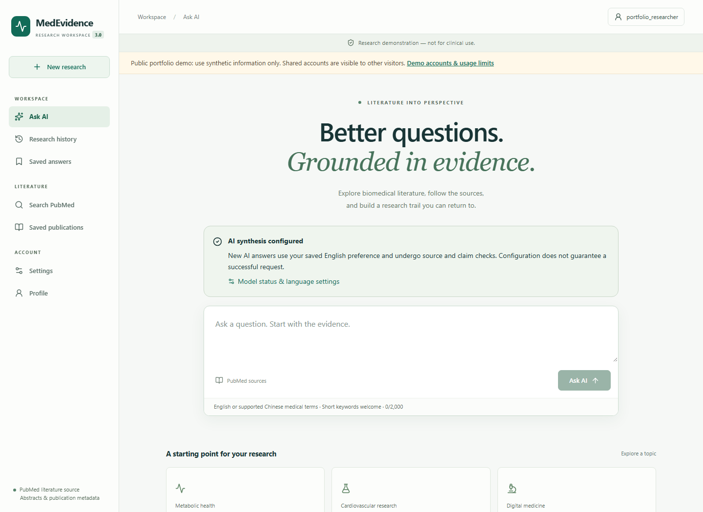
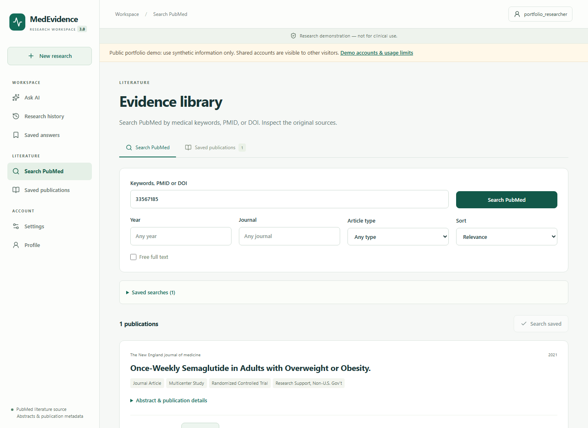
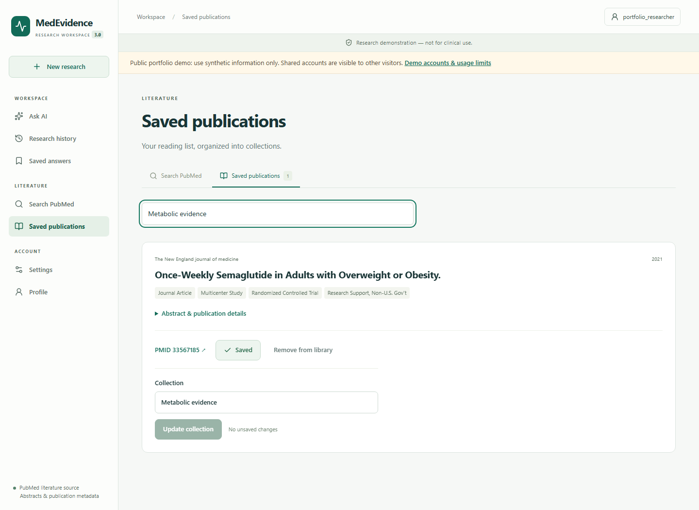
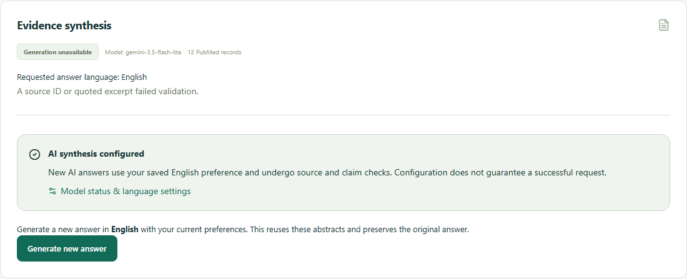
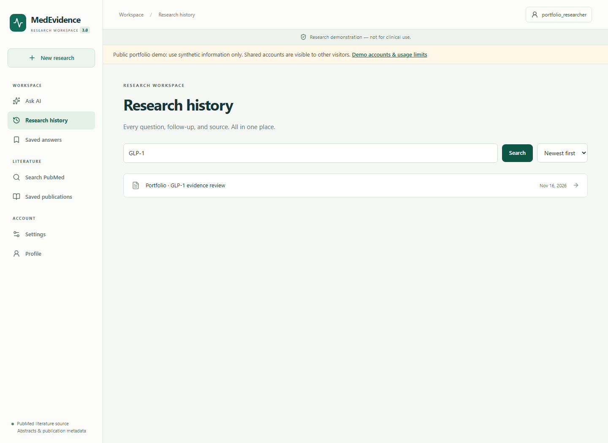
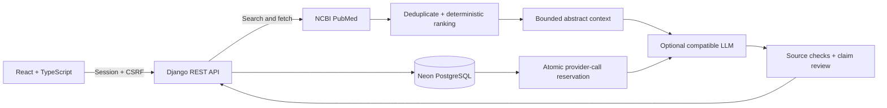

# MedEvidence AI

**A source-linked biomedical research workspace — from a clinical question to inspectable literature.**

MedEvidence AI combines real PubMed retrieval, optional abstract-grounded AI synthesis, citation checks, and a persistent research workspace. Built with React, TypeScript, Django REST Framework, and PostgreSQL, it demonstrates retrieval pipeline design, model integration, evidence provenance, and full-stack deployment.

**Research demonstration — not for clinical use.** This independent portfolio project is inspired by OpenEvidence's literature-first workflow and is not affiliated with OpenEvidence. It does not provide validated medical advice or use patient records.

[Open live demo](https://medevidence-ai-v3.onrender.com) · [Sign in](https://medevidence-ai-v3.onrender.com/profile) · [Evaluation evidence](docs/evaluation.md) · [Deployment guide](docs/public-demo.md)



## Try the public demo

The complete application runs on **Render Free**, with persistent **Neon PostgreSQL**. No installation is required. Sign in, search for PMID **33567185**, open its abstract, save the publication, and explore a GLP-1 research conversation.

The free web service sleeps after inactivity; the first request may take around a minute to wake it. The current Neon database has **no fixed 30-day expiration**. Availability depends on provider quotas; this is not an always-on production service. See [hosting details and limits](docs/public-demo.md).

### Demo accounts

| Account | Username | Password |
|---|---|---|
| Research workspace | `portfolio_researcher` | `MedEvidence-Demo-2026!` |
| Separate reviewer workspace | `portfolio_reader` | `MedEvidence-Demo-2026!` |

Both are ordinary, non-admin accounts with the same permissions. Their data is isolated from each other, but **each shared account is visible to anyone using its published credentials**. Use synthetic information only. Shared profile changes are blocked, and the application exposes no password-change endpoint. Visitors can also create their own synthetic research accounts.

The seed creates explicitly labelled synthetic welcome conversations, without invented publications or model answers. Public AI usage has a database-backed allowance of **30 provider attempts per UTC day and 200 total**, shared across all accounts. A draft and its claim review consume separate attempts. Failed calls also consume the allowance. PubMed searches and saved research remain available when AI is unavailable. [Usage controls](docs/public-demo.md#public-ai-usage-controls).

## Core features

| Capability | Implementation |
|---|---|
| Real literature search | PubMed ESearch, ESummary, EFetch; keywords, PMID or DOI; year, journal, article-type and free-full-text filters |
| Evidence inspection | Original abstracts, authors, publication dates, DOI and PMID links; evidence cards and tables |
| Optional AI synthesis | Server-side compatible-model transport, including configured Gemini; structured findings and limitations from supplied abstracts |
| Citation safeguards | PMID allowlist, exact excerpt checks, numerical consistency checks, and a separate automated claim-review pass |
| Conversation context | Follow-ups, explicit query normalization, prior questions, executed queries and source snapshots |
| Research organization | Saved publications, collections, saved searches, answer bookmarks and renameable history |
| Language preferences | Generated-response preferences; bounded Chinese medical-term mapping; source quotations retain their original language |
| Exports | Authenticated Markdown, PDF, BibTeX and CSV downloads |
| Account boundaries | Django sessions, CSRF protection, owner-scoped resources, logout and cross-tab account updates |
| Public demo safeguards | Protected synthetic accounts, server-only keys, persistent provider-call limits and fail-closed reservations |

Automated checks are **not independent clinical validation**. Rejected drafts remain unavailable; retrieved publications are retained for inspection.

## Screenshots

Actual captures from the deployed application, not mockups. **The synthesis capture shows a rejected draft: both live research requests failed source/numeric validation. No successful AI synthesis is claimed for this release.** [Capture provenance and synthesis status](docs/screenshots/README.md).

| Literature search | Saved publications |
|---|---|
|  |  |

| Evidence synthesis | Conversation history |
|---|---|
|  |  |

[Source and citation details](docs/screenshots/04-source-citation.png) · [Mobile dashboard](docs/screenshots/08-mobile-dashboard.png)

## Architecture



Render serves the compiled SPA and API from one Docker service using Gunicorn and WhiteNoise. PostgreSQL stores users, sessions, research snapshots, saved items, and the public AI allowance. Keys stay in the server environment.

This is a **retrieval-augmented, abstract-based pipeline** with deterministic ranking; it does not claim a vector database, exhaustive systematic-review coverage, or full-text retrieval. See [architecture](docs/architecture.md) and [OpenAPI](docs/openapi.yaml).

## Run locally

Requirements: **Python 3.12+**, **Node.js 24**, npm. AI is optional; literature retrieval works without a model key.

On Windows, from this repository:

```powershell
.\setup.ps1
.\start.ps1
```

Open **http://127.0.0.1:5173**. The API defaults to port **8021**. Use `.\stop.ps1` to stop launcher-managed services.

For macOS/Linux or manual setup:

```bash
cp .env.example .env
python -m venv .venv
.venv/bin/python -m pip install -r backend/requirements.txt
.venv/bin/python backend/manage.py migrate
.venv/bin/python backend/manage.py runserver 127.0.0.1:8021
```

In a second terminal:

```bash
cd frontend
npm ci
npm run dev -- --host 127.0.0.1 --port 5173 --strictPort
```

Local development defaults to SQLite. Hosting requires PostgreSQL. See [local/model setup](docs/local-development.md) for optional demo seeding and verification commands. Never commit `.env` or put provider keys in `VITE_*` variables.

## Verification and evaluation

The [portfolio release report](experiments/portfolio-release/REPORT.md) records actual results, definitions, difficulty, screenshots and limitations. MyChart results are not reused.

| Check | Recorded result | Scope |
|---|---|---|
| Backend pytest | 62 passed, 1 skipped | API, ownership, retrieval, validation, export, demo protection and quota behavior |
| Frontend Vitest | 9 passed | Component behavior |
| Playwright desktop/mobile regression | 20 passed | Mocked API fixtures; no real model claims |
| Production build | Passed | TypeScript and Vite |
| Docker + disposable PostgreSQL | 6 checks passed | Startup, migrations, SPA delivery, seed idempotence and concurrent reservations |
| Public HTTPS smoke | **17 passed, 1 failed (94.4%)** | Real browser, deployed PostgreSQL, PubMed and configured application model |
| Native OpenAI CUA | **Not executed** | 100 frozen cases remain NOT_RUN; paid execution is not authorized |

**Playwright is not native Computer Use API testing.** The frozen native-CUA suite remains on [evaluation/medevidence-native-cua-100](https://github.com/KateK77/openevidence-clone/tree/evaluation/medevidence-native-cua-100). No native-CUA pass rate is claimed. Its baseline predates these portfolio changes. See the [evaluation index](docs/evaluation.md).

## Limitations

- Research prototype, not a clinical decision system. Automated review can miss unsupported claims or reject valid ones.
- Retrieval covers PubMed metadata and available abstracts, not full texts. Bounded ranking can omit important studies.
- Provider limits and strict validation can prevent synthesis. Configured credentials do not guarantee a successful answer.
- Chinese query support uses a bounded glossary. Language settings apply to new generated responses, not original source text.
- Shared demo data is public to other users of that account. Never enter patient, personal, confidential or proprietary information.
- Free hosting can sleep or exhaust quotas. Database persistence is not a backup or uptime guarantee.
- Persistent call allowances bound application requests, not an exact provider invoice. Operators must retain the intended free tier and monitor usage.
- This release does not establish clinical accuracy, production load capacity, accessibility certification, or completion of native-CUA testing.

## Repository and development history

```text
backend/       Django API, retrieval, synthesis and persistence
frontend/      React UI, unit tests and Playwright fixtures
deploy/        Hosted and multi-service Docker profiles
docs/          Architecture, deployment and actual screenshots
experiments/   Preserved rounds and release evidence
scripts/       Local, container and public smoke runners
tests/         Backend verification
render.yaml    Opt-in new-service deployment Blueprint
```

| Milestone | Preserved record |
|---|---|
| Round 1 | [Requirements/results](experiments/round-01), tag `v0.1.0-r1` |
| Round 2 | [Feedback iteration](experiments/round-02), tag `v2.0.0-r2` |
| Round 3 | [Synthesis and hosting](experiments/round-03), tags `v3.0.0-r3`, `v3.0.0-r3-hosted` |
| Portfolio release | [Comparison plan](experiments/portfolio-release/PLAN.md), [verification](experiments/portfolio-release/REPORT.md) |

Presentation references [MyChart / CareConnect](https://github.com/KateK77/mychart-clone); medical functionality and evidence remain specific to MedEvidence.
